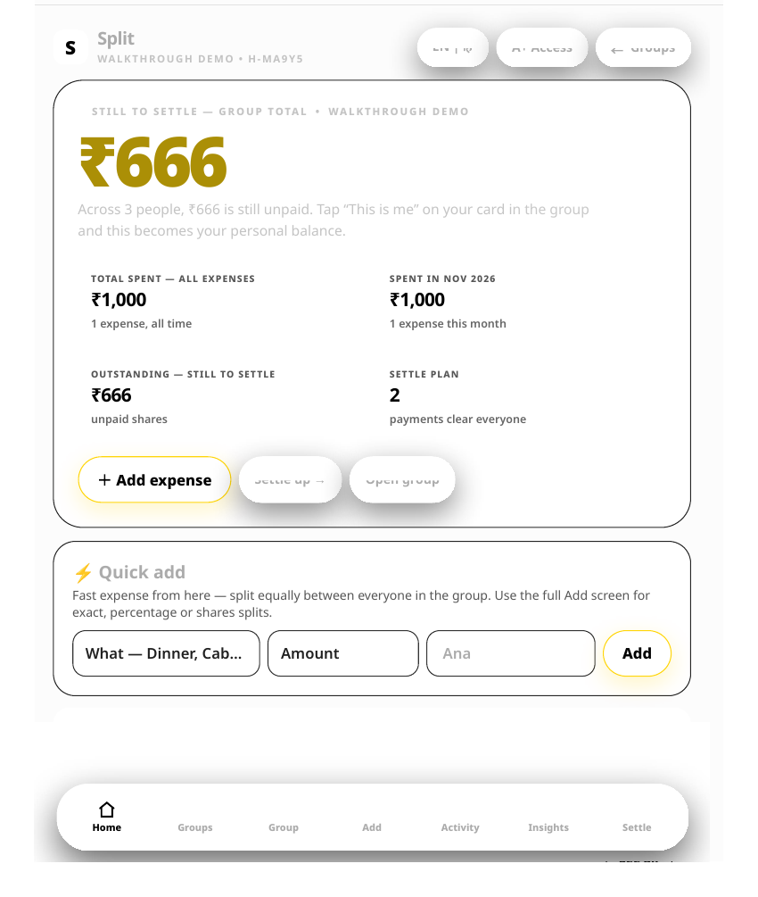
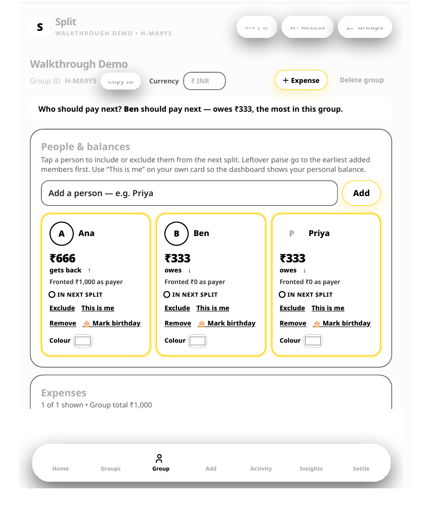
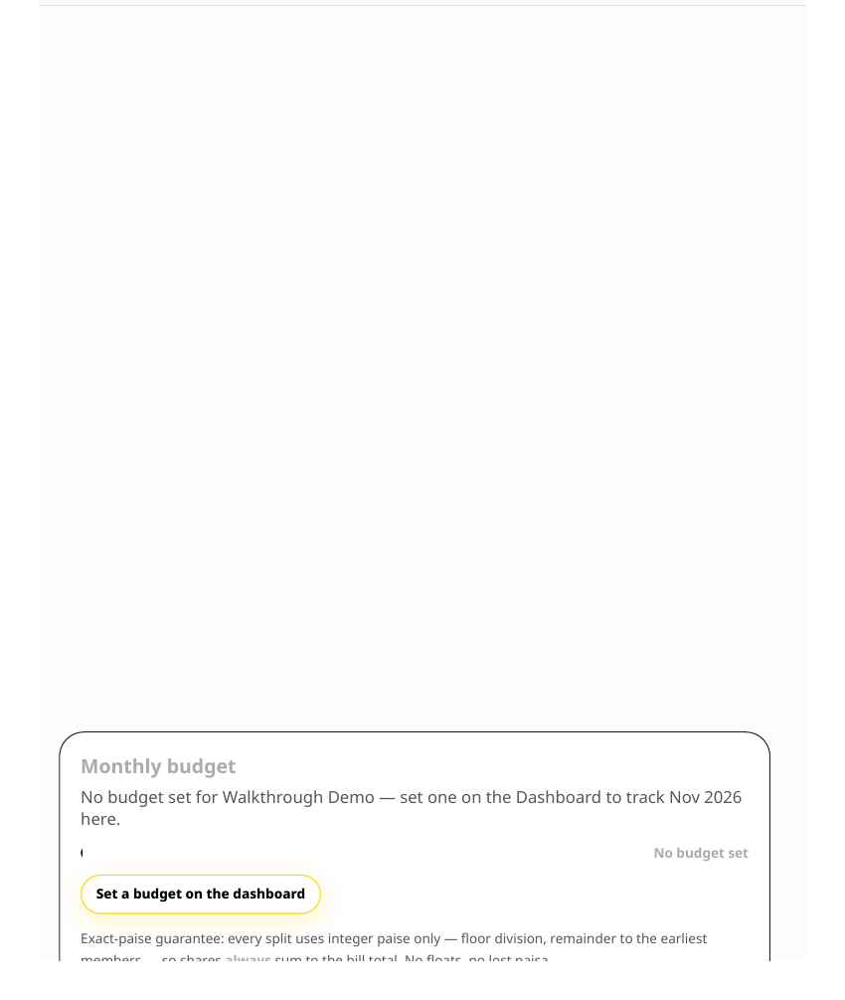
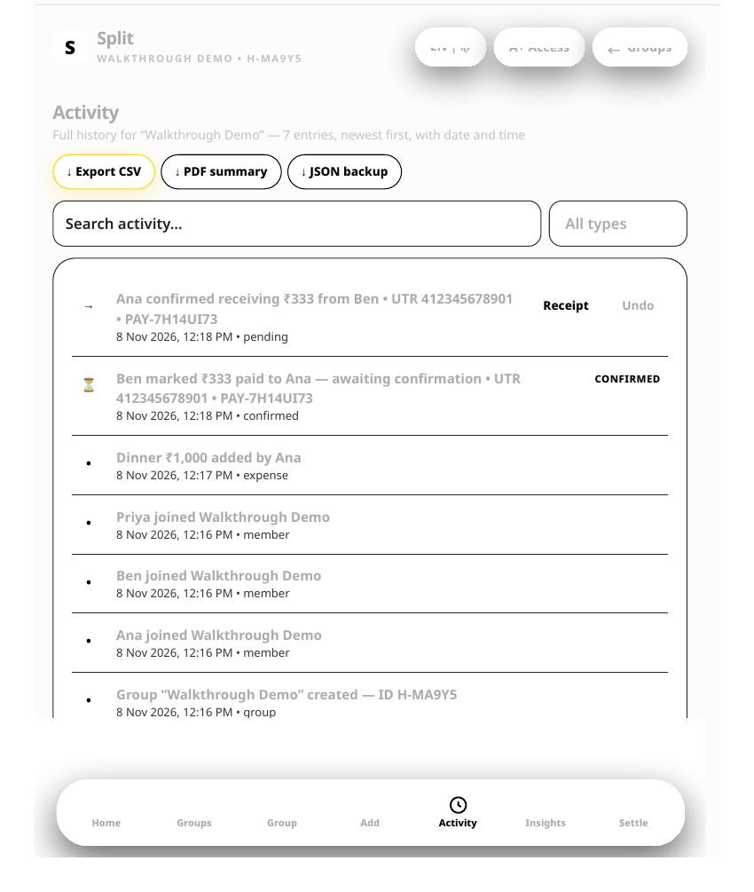

# Bill Splitter — Shared Bill Splitter

A shared-home bill splitter: create a home, add members, split bills exactly
to the cent, and pay shares safely. Built for the DoCoDeGo SDE Intern
assignment (see [The assignment brief](#the-assignment-brief) below).

**Stack:** Hono on Cloudflare Workers · Cloudflare D1 (SQLite) · React + Vite +
TanStack Router · TypeScript everywhere · Vitest · Biome · pnpm workspace.

**Tests: 71 passing** — 60 API tests (6 files) + 11 web tests (2 files),
verified by running `pnpm test` on 8 Nov 2026. `pnpm check`, `pnpm typecheck`
and `pnpm build` also pass; CI runs all four on every push and pull request.

## Live demo

- **Static demo (GitHub Pages): https://vivekgitninja.github.io/bill-splitter/**
- **Same demo (Muse): https://muse.ai/s/bill-splitter-xse6xcrfdxsxzxmxy/KczB6FZqu_610y_ROdu1oo4nMeteyd-krmK_SlR6CzA**
- **Code:** https://github.com/VivekGitNinja/bill-splitter (this repo, `main` branch)

The live demo is a **static, client-side** version of the app: it runs entirely
in the visitor's browser (data in `localStorage`), no server, no real money.
The production backend in this repo (Workers + D1) is **not deployed yet** —
see [Deploy status](#deploy-status).

## Screenshots

Screenshots from the live static demo (Walkthrough Demo group: Ana, Ben, Priya;
Dinner ₹1,000 split 334 / 333 / 333).

| Home dashboard | Group detail |
| --- | --- |
|  |  |
| ₹666 still to settle · settle plan: 2 payments | Balances per member, gross (including zero) |

| Insights | Activity feed |
| --- | --- |
|  |  |
| Fairness — who fronted more than they consumed | Every event logged with date and time |

## What this repo implements

The assignment, exactly, plus hardening for real use. Nothing in the API
changes the assignment's split or pay rules.

- **Exact split.** A bill is split once, at creation. `base =
  floor(totalCents / n)`; the first `totalCents mod n` members (in the order
  they were added) get one extra cent. Shares always add up to exactly
  `totalCents`: 1000 cents over 3 members is `334, 333, 333`. Old bills stay
  frozen when a new member joins.
- **Safe pay.** Paying is one atomic conditional `UPDATE ... WHERE paid_at
  IS NULL`, so two concurrent requests for the same share cannot both
  succeed. The `Idempotency-Key` is stored on the share: same key retried
  returns `200` with the original result; a different key on an
  already-paid share returns `409`; a missing key returns `400`.
- **Integer cents everywhere.** The API, the database, and the split math
  never see a decimal. Formatting to ₹/$ happens only on screen.
- **8 named database constraints** (foreign keys, `CHECK`s, `UNIQUE`s) as a
  safety net under the API's own validation — see [WALKTHROUGH.md](WALKTHROUGH.md).
- **Validation and limits.** Bodies capped at 16 KB (`413` above that);
  names/titles trimmed, max 200 chars; `totalCents` a safe integer from 1
  to 100,000,000; duplicate member names in one home rejected with `409`.
- **Rate limiting.** `POST /api/homes` and pay are limited to 60 requests
  per minute per client IP (`429` above that).
- **Pagination.** `GET .../members` and `GET .../bills` accept `?limit=`
  (default 50, max 100) and `?cursor=` (`nextCursor`, `null` at the end).
- **Errors and logging.** Every error is JSON `{ "error": "message" }`. A
  500 also carries an `errorId` matching one log line; every request is
  logged with method, path, status, duration, and request id.
- **Shared types.** `shared/` (`@bill-splitter/shared`) holds the `Member`,
  `Share`, `Bill`, and `Balance` types and the validation bounds, imported
  by both sides so the wire shapes cannot drift.
- **Web page.** One page showing a home's bills and shares, with clear
  **loading**, **empty**, and **error** states; a failed payment leaves the
  share visibly unpaid (never optimistic); a 15-second timeout turns a hung
  API into an error message instead of a frozen page.
- **No auth, by design.** A home id is a random UUID and acts as a bearer
  token: anyone who knows it can see and change that home. No fake auth was
  added. A real multi-user version would need accounts and per-home
  membership checks.

### Demo-only extras

The **live static demo** (GitHub Pages link above) adds product features on
top of the assignment, as a client-side showcase. These live **only in the
demo**, not in the API:

- **Two-step UTR payment:** payer marks paid with a UPI transaction ID
  (debt stays *Pending*), receiver confirms the money arrived, then a
  receipt shows Payment ID + UTR + both timestamps to the second. No other
  expense app verifies the money actually arrived.
- Exact / percentage / shares splits, partial payments, recurring bills,
  multi-currency, dispute freeze (a disputed expense leaves every balance
  until resolved), optimal settle plan (fewest payments), Insights/fairness
  dashboard, full activity feed, share via link + QR with a read-only guest
  view.

## Architecture

```
bill-splitter/
├── api/        Hono app on Cloudflare Workers (all logic in src/index.ts)
│   ├── migrations/  0001_init, 0002_indexes, 0003_timestamps,
│   │                0004_unique_member_name
│   └── test/        visible tests (homes, bills, payments, schema,
│                    security, validation) — do not change these or helpers.ts
├── web/        React + Vite + TanStack Router single-page app
│   └── src/    routes/index.tsx, typed client api.ts,
│               components (BillList, HomeForm, MemberList, PayButton)
└── shared/     @bill-splitter/shared — types + validation bounds
```

Data flow: create a home → add members (`seq` 1, 2, 3 … in add order) →
create a bill (bill + shares inserted in one D1 `batch`) → pay a share
(atomic conditional update) → balances (unpaid shares summed, in member-add
order). Full walkthrough with every constraint explained:
[WALKTHROUGH.md](WALKTHROUGH.md).

## API

| Method | Endpoint | Success | Errors |
| --- | --- | --- | --- |
| `POST` | `/api/homes` | `201 { id, name }` | |
| `POST` | `/api/homes/:homeId/members` | `201 { id, homeId, name }` | `404` home not found |
| `POST` | `/api/homes/:homeId/bills` | `201 { id, homeId, title, totalCents, shares: [...] }` | `404` home not found · `422` bad total or no members |
| `POST` | `/api/bills/:billId/shares/:shareId/pay` (header `Idempotency-Key`) | `200 { id, memberId, amountCents, paidAt }` | `400` key missing · `404` bill/share not found · `409` already paid, different key |
| `GET` | `/api/homes/:homeId/balances` | `200 { balances: [{ memberId, name, outstandingCents }] }` | `404` home not found |
| `GET` | `/api/homes/:homeId/members`, `/api/homes/:homeId/bills` | `200`, paginated | `404` home not found |

## Run it

```bash
pnpm install
pnpm dev          # api on :8787 and web on :5173, local D1
```

Open http://localhost:5173. `/api/health` returns `{ "status": "ok" }`.

```bash
pnpm test         # 71 tests: api/test + web (must pass)
pnpm check        # Biome: format and lint. Must pass.
pnpm check:fix    # fix what Biome can fix
pnpm typecheck    # tsc on both packages. Must pass.
pnpm build        # production build of the web app
```

`pnpm dev` applies migrations to a local database before it starts the API.
Node 24 and pnpm 10 are pinned (`.nvmrc`, `packageManager`).

## Deploy status

- **Static demo: live** at https://vivekgitninja.github.io/bill-splitter/
  (served from the `gh-pages` branch: one self-contained `index.html`).
- **Production backend: not deployed yet.** It needs a Cloudflare account:
  `wrangler d1 create bill-splitter`, copy the real `database_id` into
  `api/wrangler.jsonc` (it is still the `"local-only"` placeholder), apply
  migrations with `pnpm migrate:remote`, then `pnpm deploy:api` and
  `pnpm deploy:web`. Exact steps: [WALKTHROUGH.md](WALKTHROUGH.md)
  ("Deploying it live"). CI (`.github/workflows/ci.yml`) runs install,
  `pnpm check`, `pnpm typecheck`, `pnpm test`, and `pnpm build` on push and
  pull requests; `.github/workflows/deploy.yml` deploys on push to `main`.

## Decisions

1. **Pay with one atomic conditional UPDATE, and keep the idempotency key on the share.** Paying runs `UPDATE shares SET paid_at, idempotency_key WHERE id = ? AND paid_at IS NULL`, so when two requests race for the same share exactly one of them changes a row. A retry with the same key then reads the stored key and returns the original result (200), while a different key gets 409. No separate payments table is needed, and there is no read-then-write window to double-pay through.
2. **Split the bill once, at creation time, with leftover cents going to the earliest members.** Each share is `floor(total / n)` cents, and the first `total mod n` members (in the order they were added) get one extra cent, so the shares always add up to exactly `totalCents`. Computing the split once keeps reads simple and freezes each bill: adding a member later does not rewrite bills that already exist.
3. **Money is integer cents everywhere; formatting happens only on screen.** The API, the database, and the split math never see a decimal, so rounding can never lose or invent a cent. The web page only converts cents to dollars for display (`$3.34`), never for storage or calculation.

---

## The assignment brief

The text below is the task as given (DoCoDeGo SDE Intern, `sde-intern-task-002`).

Welcome. In this assignment you build a small bill splitter for a shared home. It has two parts:

1. **Homes and members:** create a home and add members to it.
2. **Bill splitting:** split a bill between the members. Each member pays their own share.

The assignment is small on purpose. We want correct, safe, and clear code. We do not want many features.

### What we look at

- **Your code passes the tests.** The tests decide, not opinion. You get the visible tests. We also run extra tests that you do not see.
- **Your code is safe when things go wrong.** Wrong input, repeated requests, and two requests at the same time must not break your data.
- **Your code is typed.** Use TypeScript. Do not use `any`.
- **You understand your code.** You record a short video and explain it.

Take your time. A careful, correct solution is better than a fast one. We expect 2 to 3 days of real work.

### Stack (required)

- **API:** Hono on Cloudflare Workers
- **Database:** Cloudflare D1 (SQLite). The binding is `DB` in `api/wrangler.jsonc`.
- **Web:** React, Vite, TanStack Router
- **Language:** TypeScript on both sides
- **Tests:** Vitest, running inside the Workers runtime
- **Quality:** Biome. `pnpm check` and `pnpm typecheck` must pass.

You choose the rest (styling, form library, validation library). Pick tools you can explain.

### The task

The assignment has two parts. Do Part 1 first. Part 2 builds on it.

**Database.** Write the schema as SQL migration files in `api/migrations/`. For example `0001_init.sql`. The tests apply every file in this folder. Your schema must have **at least 3 named constraints** that protect the data. For example a foreign key, a `CHECK`, or a `UNIQUE` key. Be ready to explain what each constraint stops. (This solution has 8 — see [WALKTHROUGH.md](WALKTHROUGH.md).)

**Errors.** Every error response is JSON: `{ "error": "message" }`.

### Part 1: Homes and members

Create a home and add members to it. The order in which members are added matters in Part 2.

#### `POST /api/homes`

- Request: `{ "name": string }`
- Success: `201` `{ id, name }`

#### `POST /api/homes/:homeId/members`

- Request: `{ "name": string }`
- Success: `201` `{ id, homeId, name }`
- Errors: `404` home not found

Visible tests: `api/test/homes.test.ts`.

### Part 2: Bill splitting

Add a bill to a home, split it between the members, and let each member pay their share.

All amounts are whole **cents** (integers). `100` cents is 1 dollar. Never use decimals for money.

#### `POST /api/homes/:homeId/bills`

- Request: `{ "title": string, "totalCents": number }`
- Success: `201` `{ id, homeId, title, totalCents, shares: [{ id, memberId, amountCents, paidAt: null }] }`
- Errors: `404` home not found. `422` total is not a positive whole number, or the home has no members.

#### `POST /api/bills/:billId/shares/:shareId/pay`

- Request: header `Idempotency-Key`
- Success: `200` `{ id, memberId, amountCents, paidAt }`
- Errors: `400` key missing. `404` bill or share not found. `409` share already paid with a different key.

#### `GET /api/homes/:homeId/balances`

- Success: `200` `{ balances: [{ memberId, name, outstandingCents }] }`
- Errors: `404` home not found

**Rules**

- **Split.** A bill is split between all members of the home. The shares always add up to `totalCents`. If the amount does not divide evenly, the extra cents go to the members one by one, in the order the members were added to the home. Example: 1000 cents between 3 members gives `334`, `333`, `333`.
- **Pay.** Paying marks one share as paid and sets `paidAt`. If the same `Idempotency-Key` is sent again for the same share, answer `200` with the same result. Do not pay twice. If two requests pay the same share at the same time, only one may succeed.
- **Balances.** `outstandingCents` is the sum of the member's unpaid shares, across all bills of the home. List the members in the order they were added.

Visible tests: `api/test/bills.test.ts` and `api/test/payments.test.ts`.

#### Web page

Build one page that:

- shows the bills of a home and the shares of each bill,
- lets a member pay a share,
- shows clear **loading**, **empty**, and **error** states,
- keeps the share unpaid and shows an error if the payment fails.

The page must not crash when the API answers with an error or is slow.

### Cases you must handle

You must handle these cases and talk about them in your video:

1. A home with no members.
2. An amount that is zero, negative, or not a whole number.
3. An amount that does not divide evenly.
4. The same payment request sent twice.
5. Two members paying the same share at the same time.
6. A bill or share that does not exist.
7. The API answers with a 500 error or is slow. The web page must not crash.

### Rules for the tests

- The visible tests are in `api/test`. They start with a failing result. Your job is to make them pass.
- Do **not** change the visible tests or `api/test/helpers.ts`. We compare them with the original.
- We run extra tests after you submit. They test the cases in "Cases you must handle" more closely.

### AI policy

You can use AI tools. Tell us which ones and where in your answers on the form.
You must understand every line you submit. We check this with your video and in a live call. "The AI wrote it" is not an answer.

**AI use on this solution:** Muse (Meta's personal AI agent) built the implementation under the author's direction; the author reviewed and verified it. The video walkthrough explains the architecture, data flow, and trade-offs.

### How to submit

1. Click **Use this template**, then **Create a new repository**. Make the repository **public**. (Done: https://github.com/VivekGitNinja/bill-splitter)
2. Build your solution in your new repository. Small, clear commits are welcome.
3. Update this README with a short section called **Decisions**. Write 3 decisions you made and why. (Done — see above.)
4. Record a video of **3 minutes or less** (Loom or unlisted YouTube). Show the architecture, the data flow, and one trade-off you made. Make sure anyone with the link can view it.
5. Paste the repository link and the video link in the application form.

We will run `pnpm install && pnpm check && pnpm typecheck && pnpm test` on your repository.
